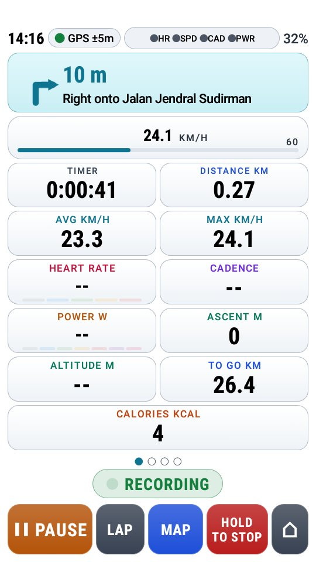
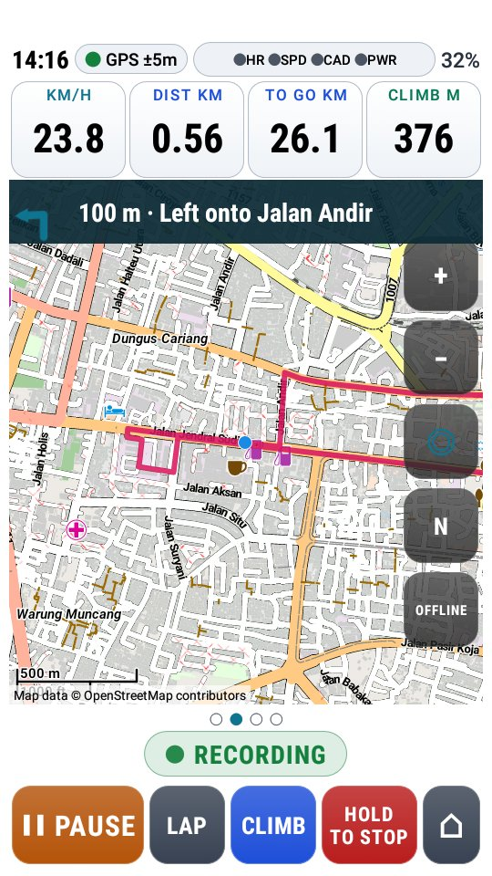
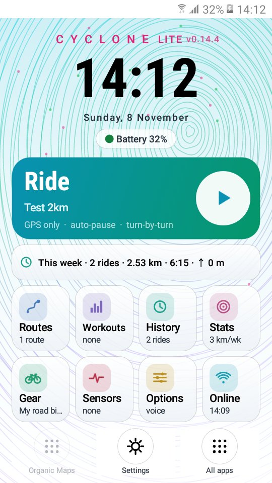

# Cyclone Lite

**A bike computer for older and low-end Android phones.** 
Cyclone for Android 6.0 and newer: big numbers, offline maps, turn-by-turn, climbs and Bluetooth sensors, on phones with 1–2 GB of memory.

### ⬇ [Download Cyclone Lite](https://github.com/zakusworo/cyclone-lite/releases/latest/download/cyclone-lite.apk)

Free · no account · no ads · about 3 MB

&nbsp;
&nbsp;

## Cyclone or Cyclone Lite?

Both are the same bike computer. Pick by your phone's Android version (Settings → About phone):

| | [Cyclone](https://github.com/zakusworo/cyclone-beta) | **Cyclone Lite** |
|---|---|---|
| Android | 8.0 and newer | **6.0 and newer** |
| New features | First | A little later, once they have proven themselves in Cyclone |
| Fixes | As soon as they are ready | Bug-fix updates as needed |
| Small screens | Fits any screen | Also draws everything a little smaller on narrow phones (like 5" 540×960 screens) |
| Home shortcuts | Komoot, Strava | Organic Maps (Komoot and Strava need Android 8) |

The two are separate apps: you can install both, and each keeps its own rides and settings.

## What's new in Lite 0.14.4

The first Cyclone Lite: everything in Cyclone 0.14.4, made to run on Android 6.0 and 7.

- **Runs on Android 6 and 7**, tested on a Samsung Galaxy J2 Prime (Android 6.0.1, 1.5 GB): GPS, recording, offline maps, turn-by-turn with street names, and saving rides.
- **Online services work on old Android.** Android before 7.1.1 doesn't trust the certificates most of Cyclone's services use (weather, routing, map search, update checks); Cyclone Lite brings its own.
- **Fits small screens.** On narrow phones the whole app is drawn a little smaller, so the home screen and the ride screen fit without cut-off buttons.
- **CYCLONE LITE** on the home screen, so you always know which app you are in.

All versions: [CHANGELOG.md](CHANGELOG.md)

## Get started

1. **Download** [`cyclone-lite.apk`](https://github.com/zakusworo/cyclone-lite/releases/latest/download/cyclone-lite.apk) on the phone, wait until it has finished, and open it. On Android 6 and 7, turn on **Settings → Security → Unknown sources** first if Android asks.
2. **Open Cyclone Lite** and allow location.
3. **Get the map for your area:** Options → Offline maps → **Find maps for my location**. Pick the smallest map that covers where you ride (Java is 918 MB, Sumatra 310 MB, Bali in Nusa Tenggara 180 MB), and check the phone has room for it. Wi-Fi recommended.
4. **Keep the recording steady:** Options → This phone → turn battery optimisation **off** for Cyclone Lite. On Samsung phones, also leave it out of the phone's own app sleeping list.
5. **Ride:** tap the big **Ride** card, then **► Start** (or press Vol+).

Already have Cyclone Lite? You don't need to download again: the app tells you when a new version is out.

<b>"There was a problem parsing the package"</b>

The download is incomplete, or the phone is older than Android 6.0. Delete the download and try again, on Wi-Fi if you can. On the [Releases](https://github.com/zakusworo/cyclone-lite/releases/latest) page, take `cyclone-lite.apk`, not "Source code".

## What it does

| Feature | What you get |
|---|---|
| 🚴 **Ride screen** | Speed, time, distance, averages, heart rate, cadence, power, altitude, calories. Four pages (data, map, climb, ahead) switched with a button or the volume keys, so it works with gloves. |
| 🌗 **Day and night** | Black on white in the sun, white on black after dark. Auto by sunrise and sunset, or pick one in Options. |
| 🗺️ **Maps and routes** | Offline maps for your area. Routes from Google Maps (share the link to Cyclone), GPX, KML or KMZ. Turn-by-turn with street names, an off-course alarm, and the way back worked out offline. |
| ⛰️ **Climbs** | The climb profile coloured by gradient, the next climb on your route, and metres left to the top. |
| 📡 **Sensors** | Bluetooth heart rate, speed, cadence and power. ANT+ too on phones that have it. Each bike keeps its own tyre size and sensors. |
| 🏋️ **Training** | Heart rate and power zones, structured workouts (.zwo files or from Intervals.icu), auto-lap, eat and drink reminders, spoken cues. |
| 🌦️ **Ahead** | Weather along your route and BMKG weather warnings (Indonesia). |
| 📊 **After the ride** | Summary with charts, climbs and best efforts; history, personal records, weekly goals and streaks. Rides are saved as .fit and .gpx files for Strava, Intervals.icu, Garmin Connect or Komoot. |
| 🆘 **Safety** | Crash detection: after a hard fall and no movement, a message with your location goes to your contact (via ntfy or Telegram) unless you press I'M OK. |

How to use every screen: the [Cyclone tutorial](https://github.com/zakusworo/cyclone-beta/blob/main/TUTORIAL.md) (the screens are the same in Lite).

## Known limits on old Android

- **Stops along the route** (water, minimarkets, toilets) don't load on Android 6 to 9 yet: the map server for them now needs a connection type these Android versions don't have. A fix is coming.
- **Offline maps on Android 6 and 7** download over a plain connection, because Android's own downloader can't use the certificates Cyclone Lite brings. Each map is checked against its known size and header before it is used.
- **Strava's app** needs Android 8, so "Strava (web)" opens Strava's upload page in the phone's browser instead. Old browsers may struggle with it; uploading from a computer always works.
- **Altitude** comes from GPS on phones without a barometer, and is corrected from terrain data once the phone is online.

## Questions

<b>Which phones work?</b>

Any phone with Android 6.0 or newer and GPS. Cyclone Lite was tested on a Samsung Galaxy J2 Prime (SM-G532G, Android 6.0.1, 1.5 GB of memory, 540×960 screen). On a phone with Android 8.0 or newer you can also use [Cyclone](https://github.com/zakusworo/cyclone-beta), which gets new features first.

<b>Does it need internet?</b>

No, not while riding: GPS works without mobile data, and with the offline map and routing data for your area (downloaded once, on Wi-Fi) maps, routes and the way back all work offline. Weather, warnings and uploads update whenever the phone is online.

<b>The map takes a lot of space. What can I do?</b>

Pick the smallest map that covers where you ride: Indonesia comes as one map (1.85 GB) or by island (Java 918 MB, Sumatra 310 MB, Sulawesi and Nusa Tenggara 180 MB, Kalimantan 167 MB, Papua 59 MB, Maluku 52 MB). Without an offline map the map page loads online maps instead.

<b>How do I get my rides on Strava?</b>

After a ride, tap **Strava (web)** on the summary (or in Online → your rides). Cyclone Lite saves the ride into **Download/Cyclone** and opens Strava's upload page in your browser: tap **Choose Files** and pick it. If the phone's browser can't manage, copy the .fit file to a computer and upload it there. **Intervals.icu** uploads by itself: paste your free API key and athlete ID in Online.

<b>What happens to my data?</b>

Rides stay on your phone. Nothing is uploaded unless you connect Intervals.icu or Strava, press Strava (web), send a problem report, or a crash alert goes to your contact. Weather, warnings and terrain heights come from free public services (Open-Meteo, BMKG, OpenStreetMap), which get the route or your position to answer. No account, no ads, no tracking.

## Updates

Cyclone Lite checks for a new version twice a day and shows a notification when one is out. Tap it to download and install (Android asks you to confirm). You can also check in **Options → Beta & updates**. Your rides and settings are kept.

## Found a problem?

**Cyclone Lite closed by itself or froze?** Go to **Options → Beta & updates → Send problem report**, or tap the "Cyclone Lite closed unexpectedly" notification. Your e-mail app opens addressed to Cyclone support (cyclonebikeco@gmail.com) with the report attached; press Send. The report holds the app's own log, the phone model, the app version and the active route's name, not your rides.

For anything else, open an [issue](https://github.com/zakusworo/cyclone-lite/issues/new). Say what you did, what happened and what you expected, and your phone model and Android version (**Options → Beta & updates → Copy phone details** gives them).

---

This repository hands out the Cyclone Lite builds; the app's source code is not here. 
Maps: © OpenStreetMap contributors, built by the [Mapsforge](https://github.com/mapsforge/mapsforge) project. Bike routing: the [BRouter](https://github.com/abrensch/brouter) engine (MIT licence) with routing data from brouter.de. Weather and terrain heights: [Open-Meteo](https://open-meteo.com). Weather warnings: BMKG.
